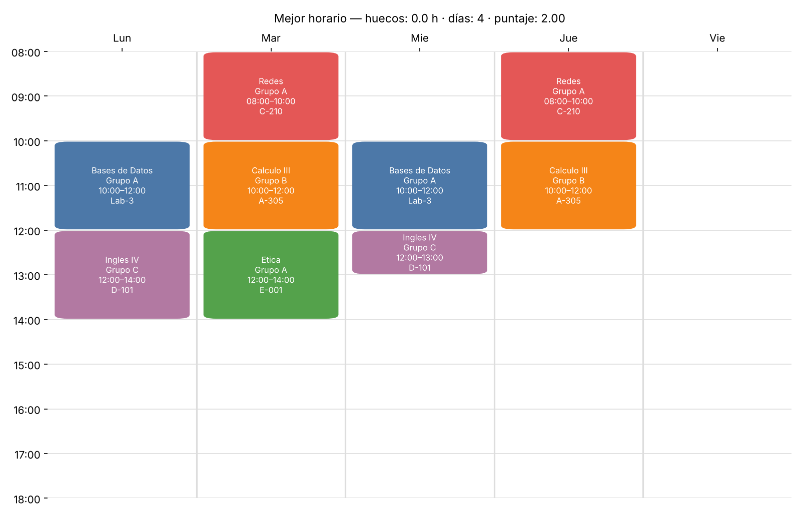

# Creador de horarios 🗓️

Arma automáticamente el **mejor horario del semestre** a partir de los grupos disponibles de cada materia:
**sin cruces**, con las clases **seguidas (sin huecos)** y, de preferencia, **entre las 8:00 a. m. y las 6:00 p. m.**



## ¿Qué hace?

Le das un archivo con las materias que quieres ver y los grupos (NRC) de cada una con sus días y horas.
El programa escoge **un grupo por materia** y te muestra los mejores horarios posibles.

Cada horario recibe un **puntaje** (menos es mejor; puede ser negativo):

| Situación | Puntos |
|---|---|
| Dos clases se cruzan | ❌ descartado |
| Cada hora de **hueco** entre clases del mismo día | +1 |
| Cada hora de clase **antes de las 8:00** | +2 |
| Cada hora de clase **después de las 18:00** | +2 |
| Cada **día** que hay que ir a la universidad | +0,5 |
| Tener que ir el **viernes** (se premia el viernes libre) | +1,5 |
| Cada hora de clase el **lunes** 🎉 | −0,5 |

**¿Por qué premiar los lunes?** En Colombia casi todos los festivos caen lunes (Ley Emiliani),
así que las clases del lunes se pierden seguido y el semestre queda más liviano.

Los pesos se cambian en [`horario/costo.py`](horario/costo.py) (`PESOS`, `HORA_INICIO`, `HORA_FIN`).

## Cómo usarlo

Necesitas **Python 3.9 o más reciente**.

```bash
# 1. Instalar la librería para dibujar el horario
pip install -r requirements.txt

# 2. Correr con el ejemplo
python main.py ejemplos/cursos.csv

# 3. Ver los 5 mejores y guardar la imagen con otro nombre
python main.py ejemplos/cursos.csv --top 5 --imagen mi_horario.png
```

Salida en la consola:

```
Materias: 5
Combinaciones posibles: 162
Nodos revisados: 24 | tiempo: 0.5 ms

Opción 1 (puntaje -1.50)
Hora   Lun             Mar             Mie             Jue             Vie
08:00  Calculo III (A)                 Calculo III (A)
10:00  Bases de Da (A)                 Bases de Da (A)
12:00  Ingles IV (C)   Etica (A)       Ingles IV (C)
14:00  Redes (B)                       Redes (B)
...
Huecos: 1.0 h | Antes de las 8: 0.0 h | Después de las 6 p. m.: 0.0 h | Días: 3 | Lunes: 8.0 h | Viernes: libre | Puntaje: -1.50
```

## Formato de los cursos (CSV)

Una fila por **cada sesión** de clase. Si un grupo ve clase lunes y miércoles, son dos filas:

```csv
materia,grupo,dia,inicio,fin,profesor,salon
Calculo III,A,Lun,08:00,10:00,Perez,A-201
Calculo III,A,Mie,08:00,10:00,Perez,A-201
Calculo III,B,Mar,10:00,12:00,Gomez,A-305
```

- `dia`: `Lun`, `Mar`, `Mie`, `Jue`, `Vie` o `Sab`
- `inicio` y `fin`: hora en formato 24 h (`14:00` = 2 p. m.)
- `profesor` y `salon` son opcionales

Puedes armar el archivo en Excel y guardarlo como **CSV UTF-8**.

## ¿Cómo funciona por dentro?

Usa **backtracking con poda** (ramificación y poda):

1. Ordena las materias de la que tiene menos grupos a la que tiene más.
2. Escoge un grupo de la primera materia, luego uno de la segunda, y así sucesivamente.
3. Si un grupo **se cruza** con lo que ya escogió, lo descarta y prueba otro (*backtracking*).
4. Si lo escogido hasta ahora **ya no puede superar** a los mejores horarios encontrados, deja de explorar ese camino (*poda*).
5. Al completar todas las materias, guarda el horario si está entre los mejores.

**Detalle de la poda:** la cota usa solo las horas fuera de rango y los días usados, porque esos
puntos solo pueden **subir** al agregar materias. Los huecos **no** entran en la cota: una materia
nueva puede caer en medio de un hueco y taparlo, así que los huecos pueden **bajar**.
El premio del lunes también hace **bajar** el puntaje, así que la cota resta de una vez el máximo
premio de lunes que todavía podrían dar las materias que faltan.

Sin poda habría que revisar el producto de los grupos de todas las materias
(por ejemplo, 6 materias con 4 grupos = 4⁶ = 4.096 horarios). La poda revisa muchos menos.

## Estructura del proyecto

```
creador-horarios/
├── main.py              # punto de entrada (línea de comandos)
├── horario/
│   ├── datos.py         # lee el CSV
│   ├── costo.py         # puntaje: huecos, horas fuera de rango, días
│   ├── buscador.py      # backtracking con poda
│   └── mostrar.py       # tabla en consola e imagen PNG
├── ejemplos/cursos.csv  # datos de ejemplo
├── tests/               # pruebas (la poda da lo mismo que la fuerza bruta)
└── docs/ejemplo.png
```

## Pruebas

```bash
python tests/test_buscador.py
```

Comprueban que la búsqueda con poda encuentra el mismo óptimo que probar todas las combinaciones.

## Próximas ideas

- [ ] Leer los cursos directamente desde una **captura de pantalla** (OCR).
- [ ] Bloquear horas (por ejemplo, "los martes trabajo de 2 a 6").
- [ ] Preferir o evitar profesores.
- [ ] Interfaz web.

## Origen

Nació a partir del proyecto de **Matemáticas Computacionales (UNAB)**, donde se resolvió el reparto
de prácticas de un laboratorio con backtracking, poda y gradiente descendente.

## Licencia

[MIT](LICENSE) — David Angarita Avendaño
