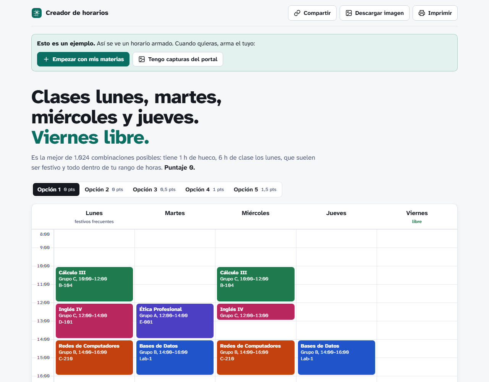

# Creador de horarios 🗓️

Arma automáticamente el **mejor horario del semestre** a partir de los grupos disponibles de cada materia:
**sin cruces**, con las clases **seguidas (sin huecos)** y, de preferencia, **entre las 8:00 a. m. y las 6:00 p. m.**
Además premia tener el **viernes libre** y las clases de los **lunes**, que en Colombia suelen ser festivo.

**Úsalo en el navegador, sin instalar nada:** https://davidangaritaa.github.io/creador-horarios/



## ¿Qué hace?

Escribes (o pegas desde una captura) las materias que quieres ver y los grupos (NRC) de cada una
con sus días y horas. La página escoge **un grupo por materia** y te muestra los mejores horarios posibles.

Cada horario recibe un **puntaje** (menos es mejor; puede ser negativo):

| Situación | Puntos |
|---|---|
| Dos clases se cruzan | ❌ descartado |
| Cada hora de **hueco** entre clases del mismo día | +1 |
| Cada hora de clase **antes de las 8:00** | +2 |
| Cada hora de clase **después de las 18:00** | +2 |
| Cada **día** que hay que ir a la universidad | +0,5 |
| Tener que ir el **viernes** (se premia el viernes libre) | +1,5 |
| Cada hora de clase el **lunes** 🎉 | −0,5 |
| Cada materia con un **profesor que quieres evitar** | +5 |

**¿Por qué premiar los lunes?** En Colombia casi todos los festivos caen lunes (Ley Emiliani),
así que las clases del lunes se pierden seguido y el semestre queda más liviano.

**Profesores que prefieres evitar.** Se prefieren los grupos con otro profesor. Si una materia
solo tiene grupos con él, la materia se queda y te avisa (si no lo quieres por nada del mundo,
sube los puntos a 100).

**Horas ocupadas.** Si trabajas o tienes algo fijo (por ejemplo, "los martes de 2 a 6" o "de lunes
a viernes de 6 a 8 a. m."), lo marcas como hora ocupada, para uno o varios días a la vez: ningún grupo que se cruce con ella entra en el horario, y si queda entre dos
clases **no cuenta como hueco**.

**Grupos fijos.** Si ya tienes asegurado un grupo, o quieres ver una materia sí o sí con cierto
profesor, lo escoges en **"Tus grupos"**, justo debajo del horario: cada materia tiene un menú con
todos sus grupos (aunque no hayan salido en ninguna opción). Esa materia queda fija en ese grupo y el
resto del horario se arma alrededor.

Los puntos de cada regla y el rango de horas se cambian en la misma página, en **"Cómo se califica"**.

## Cómo usarlo

No hay que instalar nada. Abre [`index.html`](index.html) con doble clic, o entra a la versión publicada en
**https://davidangaritaa.github.io/creador-horarios/**.

- **Arriba ves el resultado**: un titular que describe el mejor horario (por ejemplo, *"Clases lunes,
  martes y miércoles. Viernes libre."*) y el horario de la semana en un tablero, con un color y una sigla
  por materia (como las líneas de un mapa de transporte). Puedes comparar las mejores opciones e imprimirlo o guardarlo en PDF.
- **La primera vez** ves un horario de ejemplo, con botones para **empezar con tus materias** o
  **pasar capturas del portal**.
- **En "Tus grupos"**, debajo del horario, está cada materia con el grupo escogido y un menú para
  cambiarlo: el que escojas queda fijo y lleva una chincheta en el horario.
- **En "Profesores que prefieres evitar"**, también debajo del horario, aparecen los profesores de
  tu tabla: tocas los que no quieres y quedan tachados.
- **Abajo pones tus datos en tres pasos** (los dos últimos son opcionales). Mientras editas,
  el botón **Ver mi horario** te lleva de vuelta arriba.
- **Compartir** copia un enlace con tus materias y el horario que estás viendo (en el celular abre
  el menú para mandarlo por WhatsApp). Quien lo abra ve lo mismo que tú; si ya tenía sus propias
  materias, quedan guardadas y puede volver a ellas con un botón.
- **Descargar imagen** guarda el horario como imagen PNG, con los colores, los salones y la lista
  de grupos y profesores, lista para mandar o ponerla de fondo de pantalla.
- **En "1. Tus materias"** escribes los grupos en la tabla o cargas tu CSV (también acepta el CSV con `;`
  que guarda Excel en español). El horario se recalcula solo con cada cambio.
- **En "2. Tus horas ocupadas"** marcas el trabajo, el deporte o lo que no puedas mover. Cada una
  puede valer para varios días: eliges los días con botones o con el atajo **Lun a Vie**.
- **En "3. Cómo se califica"** ajustas las reglas, escritas como frases: cuánto pesan los huecos,
  el rango de horas, el viernes libre y el premio del lunes.
- **"Pasar este horario a tu calendario"** descarga un archivo `.ics` con las clases de todo el
  semestre para Google Calendar, Outlook o el celular: se repiten cada semana, **se saltan los
  festivos de Colombia** (calculados con la Ley Emiliani y la Semana Santa) y te avisan 15 minutos antes.

Todo se calcula en tu navegador: los datos no se envían a ningún lado, y la página recuerda tus
materias si la cierras. El enlace para compartir lleva los datos comprimidos después del `#`, una
parte de la dirección que el navegador no le manda a ningún servidor.

### Pasar capturas del portal con una IA

Si tienes capturas de la oferta de grupos, no tienes que escribirlas a mano:

1. En la página, abre **"¿Tienes capturas del portal?"** y copia las instrucciones.
2. Pégalas en una IA que acepte imágenes (Claude, ChatGPT, Gemini…) junto con tus capturas.
3. Copia la respuesta, pégala en la página y elige **Agregar a mi tabla** o **Reemplazar mi tabla**.

Para probarlo, en [`ejemplos/`](ejemplos) hay tres capturas de muestra, una por materia y con tres
grupos cada una: un portal en computador ([`foto-calculo-iii.png`](ejemplos/foto-calculo-iii.png)),
una pantalla de celular ([`foto-redes.png`](ejemplos/foto-redes.png)) y una foto inclinada y con
reflejo tomada a un monitor ([`foto-bases-de-datos.png`](ejemplos/foto-bases-de-datos.png)).

## Formato de los cursos (CSV)

Para cargar un archivo con **Cargar CSV** (o descargarlo con **Descargar CSV**), va una fila por
**cada sesión** de clase. Si un grupo ve clase lunes y miércoles, son dos filas:

```csv
materia,grupo,dia,inicio,fin,profesor,salon
Cálculo III,A,Lun,07:00,09:00,Andrés Pérez,A-201
Cálculo III,A,Mie,07:00,09:00,Andrés Pérez,A-201
Cálculo III,B,Mar,09:00,11:00,Laura Gómez,A-305
```

- `dia`: `Lun`, `Mar`, `Mie`, `Jue`, `Vie` o `Sab`
- `inicio` y `fin`: hora en formato 24 h (`14:00` = 2 p. m.); también entiende `2:00 p. m.`
- `profesor` y `salon` son opcionales

Puedes armar el archivo en Excel y guardarlo como **CSV UTF-8**.

## ¿Cómo funciona por dentro?

El detalle completo (mapa de funciones, formato del enlace, diseño) está en [`docs/PROYECTO.md`](docs/PROYECTO.md).

Todo el cálculo está en [`index.html`](index.html), en JavaScript, y usa **backtracking con poda**
(ramificación y poda):

1. Ordena las materias de la que tiene menos grupos a la que tiene más.
2. Escoge un grupo de la primera materia, luego uno de la segunda, y así sucesivamente.
3. Si un grupo **se cruza** con lo que ya escogió, lo descarta y prueba otro (*backtracking*).
4. Si lo escogido hasta ahora **ya no puede superar** a los mejores horarios encontrados, deja de explorar ese camino (*poda*).
5. Al completar todas las materias, guarda el horario si está entre los mejores.

Antes de empezar deja solo el grupo fijo en las materias que tengan uno y quita los grupos que
caen en **horas ocupadas**. Si alguna materia se queda sin
grupos (por ejemplo, todos sus grupos son en la mañana y trabajas en la mañana), avisa que esa
materia **no cabe** y arma el mejor horario con las demás.

**Detalle de la poda:** la cota usa solo las horas fuera de rango y los días usados, porque esos
puntos solo pueden **subir** al agregar materias. Los huecos **no** entran en la cota: una materia
nueva puede caer en medio de un hueco y taparlo, así que los huecos pueden **bajar**.
El premio del lunes también hace **bajar** el puntaje, así que la cota resta de una vez el máximo
premio de lunes que todavía podrían dar las materias que faltan. Los profesores evitados solo
pueden subir el puntaje, así que también entran en la cota.

Sin poda habría que revisar el producto de los grupos de todas las materias
(por ejemplo, 6 materias con 4 grupos = 4⁶ = 4.096 horarios). La poda revisa muchos menos.

## Estructura del proyecto

```
creador-horarios/
├── index.html           # toda la aplicación: algoritmo, festivos, calendario .ics e interfaz
├── ejemplos/
│   ├── cursos.csv       # ejemplo: 5 materias de un semestre, 4 grupos cada una
│   └── foto-*.png       # capturas de muestra para probar la lectura con IA
├── tests/pruebas.js     # pruebas (se corren con Node.js)
└── docs/                # imágenes del README y PROYECTO.md (cómo está hecho por dentro)
```

## Pruebas

Necesitas [Node.js](https://nodejs.org/) (solo para las pruebas; la página no lo necesita):

```bash
node tests/pruebas.js
```

Toman la lógica de `index.html` y comprueban, entre otras cosas, que:

- la búsqueda con poda encuentra **el mismo óptimo que probar todas las combinaciones**, en 500
  casos al azar con horas ocupadas, profesores evitados, grupos fijos y pesos distintos;
- las horas ocupadas entre clases no cuentan como hueco y el premio del lunes funciona;
- el enlace para compartir devuelve exactamente lo mismo que se guardó;
- se leen bien los CSV (con `,` o `;`, tildes, a. m. / p. m.) y las respuestas pegadas desde una IA;
- los festivos de 2026 coinciden con la lista oficial y el archivo `.ics` sale bien armado.

## Próximas ideas

- [x] Interfaz web que no necesita instalar nada.
- [x] Pasar **capturas de pantalla** a la tabla (con cualquier IA, copiando y pegando).
- [ ] Hacerlo en un solo clic (subir la foto directo a la página, con un servidor que llame a la API).
- [x] Bloquear horas (por ejemplo, "los martes trabajo de 2 a 6").
- [x] Exportar el horario al calendario (`.ics`), sin los festivos de Colombia.
- [x] Evitar profesores.
- [x] Fijar un grupo ("quiero sí o sí Cálculo con Gómez").
- [x] Compartir el horario con un enlace y descargarlo como imagen.
- [ ] Materias opcionales ("quiero ver 5 de estas 7") o un máximo de créditos.
- [ ] Teoría y laboratorio amarrados (dos NRC que van juntos).

## Origen

Nació a partir del proyecto de **Matemáticas Computacionales (UNAB)**, donde se resolvió el reparto
de prácticas de un laboratorio con backtracking, poda y gradiente descendente.

La primera versión fue un programa en **Python** para la consola. Ahora todo vive en la página web,
pero esa versión sigue en el historial:
[código en Python](https://github.com/davidangaritaa/creador-horarios/tree/d962674).

## Licencia

[MIT](LICENSE) — David Angarita Avendaño
