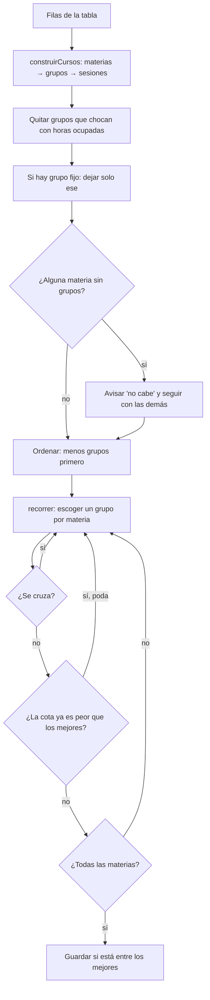

# Creador de horarios: cómo está hecho

Página web que arma el **mejor horario del semestre** a partir de los grupos (NRC) de cada materia: sin cruces, con las clases seguidas y dentro de un rango de horas. Todo pasa en el navegador: no hay que instalar nada y no hay servidor.

- **Repositorio**: https://github.com/davidangaritaa/creador_horarios
- **Página publicada**: https://davidangaritaa.github.io/creador-horarios/ (todavía sale del repositorio viejo)
- **Documentación de uso**: [README](../README.md)

---

## 1. Qué hace, en pocas palabras

1. El estudiante escribe sus materias y los grupos de cada una (día, hora, profesor, salón). También puede cargar un CSV o pasar capturas del portal por una IA.
2. La página prueba combinaciones, **un grupo por materia**, y descarta las que tienen cruces.
3. A cada horario le pone un **puntaje** (menos es mejor) y muestra los mejores.
4. El resultado se puede ajustar (fijar grupos, evitar profesores, horas ocupadas), compartir por enlace, descargar como imagen, imprimir o pasar al calendario (`.ics`).

---

## 2. Archivos

```
creador-horarios/
├── index.html           # TODA la aplicación (~2.070 líneas): estilos, lógica e interfaz
├── tests/pruebas.js     # 13 pruebas con Node.js (toman la lógica de index.html)
├── ejemplos/
│   ├── cursos.csv       # el mismo ejemplo que trae la página (5 materias × 4 grupos)
│   └── foto-*.png       # 3 capturas de portal para probar la lectura con IA
├── docs/
│   ├── web.png          # captura para el README
│   └── PROYECTO.md      # este documento
├── README.md            # documentación pública
├── LICENSE              # MIT
├── .gitignore
```

> **Un solo archivo**
> `index.html` no depende de nada externo salvo la fuente (Google Fonts). Se abre con doble clic y funciona.

---

## 3. Cómo se califica un horario

| Situación | Puntos | Clave en `pesos` |
|---|---|---|
| Dos clases se cruzan | descartado | — |
| Cada hora de **hueco** entre clases del mismo día | +1 | `hueco` |
| Cada hora **antes** del inicio del rango (8:00) | +2 | `temprano` |
| Cada hora **después** del fin del rango (18:00) | +2 | `tarde` |
| Cada **día** que hay que ir | +0,5 | `dia` |
| Ir el **viernes** | +1,5 | `viernes` |
| Cada hora de clase el **lunes** (festivos, Ley Emiliani) | −0,5 | `lunes` |
| Materia con un **profesor evitado** | +5 | `profesor` |

Los valores iniciales están en `PESOS_INICIALES` y se cambian en la página, en **"3. Cómo se califica"**.

**Horas ocupadas** (trabajo, deporte): ningún grupo que se cruce con ellas entra, y si quedan entre dos clases **no cuentan como hueco**.

---

## 4. El algoritmo: backtracking con poda

Está en `buscar(cursos, cfg)`.



**La cota (poda)** solo usa lo que puede **subir** al agregar materias: horas fuera de rango, días usados y profesores evitados. Los huecos **no** entran porque una materia nueva puede taparlos. Al premio del lunes, que baja el puntaje, se le resta de una vez el máximo que aún podrían dar las materias que faltan.

`buscar` devuelve `{ mejores, nodos, cortado, sinGrupo, fijados, combinaciones, sinCupo, quitadas }`.

**No pude matricularla.** Al marcar un grupo sin cupo (o quitar una materia), `reacomodar` primero intenta dejar las otras materias en sus grupos (quedan fijas, porque ya las matriculaste). Si así la materia no cabe, busca el mejor horario sin esa restricción y avisa qué materias hubo que mover.

> **Con el ejemplo**
> 5 materias × 4 grupos = **1.024 combinaciones**. El mejor horario cuesta **0**: lunes a jueves, viernes libre.

---

## 5. Mapa de `index.html`

El archivo tiene tres partes: estilos (`<style>`), marcado (HTML) y un `<script>`. Dentro del script, la **lógica** va entre marcadores para que las pruebas la puedan extraer.

### Lógica (desde la línea ~530 hasta `// ---8<--- fin de la lógica`)

| Función | Para qué |
|---|---|
| `aMinutos`, `aHora`, `normalizarDia`, `sinTildes` | Convertir horas y días |
| `seCruzan`, `grupoChoca`, `chocaConBloqueos` | Detectar cruces |
| `horasDeHueco`, `detalleCosto`, `cotaInferior` | Calcular puntaje y cota |
| `tieneProfeEvitado`, `claveMateria` | Profesores evitados y grupos fijos |
| `sinCupoGrupo` | ¿Ese grupo quedó sin cupo? |
| `buscar` | Backtracking con poda (sin las materias quitadas ni los grupos sin cupo) |
| `armar` | Llama a `buscar` y, si alguna materia no cabe, arma el horario con las demás |
| `construirCursos` | Pasa las filas de la tabla a materias con grupos |
| `parsearCSV`, `generarCSV`, `extraerCSVDeRespuesta` | CSV (con `,` o `;`) y respuestas de la IA |
| `domingoDePascua`, `festivosColombia`, `generarICS` | Festivos de Colombia y archivo de calendario |
| `empacarEstado`, `desempacarEstado` | Estado corto para el enlace de compartir |

### Interfaz (después del marcador)

| Pieza | Funciones |
|---|---|
| Estado y guardado | `estado`, `cargarEstado`, `guardarEstado` (localStorage `creador-horarios-v1`) |
| Utilidades | `el()` crea elementos, `icono()`, `siglas()`, `colores()`, `avisar()` (mensaje flotante) |
| Edición | `pintarFilas`, `pintarBloqueos`, `selectorDias`, `pintarPrefs`, `importarPegado` |
| Cálculo | `cambio()` → `calcular()` → `pintarResultado()` |
| Resultado | `escribirTitular`, `dibujarCuaderno` (el tablero), `pintarVacio`, `elegirOpcion` |
| Grupos y profesores | `describirGrupo`, `fijarGrupo`, `soltarFijos`, `pintarProfes` |
| No pude matricularla | `grupoSinCupo`, `quitarMateria`, `reacomodar`, `devolverCupos`, `devolverMaterias`, `pintarNoPudiste` |
| Compartir | `codificarEnlace`, `decodificarEnlace`, `abrirEnlace`, `pintarTodo` |
| Imagen | `imagenHorario`, `partirTexto`, `rectRedondo` |
| Calendario | `prepararCalendario`, `semestrePorDefecto` |
| Navegación | `irA`, `ACCIONES` (botones con `data-accion`), botón flotante "Ver mi horario" |

### Orden de la página

1. Encabezado: logo y botones **Compartir**, **Descargar imagen**, **Imprimir**.
2. Avisos: "abriste un enlace compartido" y "esto es un ejemplo".
3. Titular (por ejemplo, *"Clases lunes a jueves. Viernes libre."*), opciones y **tablero** del horario.
4. **Tus grupos**: un menú por materia para fijar el grupo, y **No pude matricularla** (grupo sin cupo o no la voy a ver). Debajo, **Lo que no pudiste matricular** para deshacer.
5. **Profesores que prefieres evitar**.
6. Exportar (calendario, CSV) y estadísticas.
7. Edición en 3 pasos: **1. Tus materias**, **2. Horas ocupadas**, **3. Cómo se califica**.

---

## 6. Datos

### Formato CSV (una fila por sesión)

```csv
materia,grupo,dia,inicio,fin,profesor,salon
Cálculo III,A,Lun,07:00,09:00,Andrés Pérez,A-201
Cálculo III,A,Mie,07:00,09:00,Andrés Pérez,A-201
```

`dia`: Lun, Mar, Mie, Jue, Vie, Sab. Las horas van en 24 h, aunque también entiende `2:00 p. m.`.

### Estado guardado

```js
estado = {
  filas,              // las filas de la tabla
  pesos,              // puntos de cada regla
  horaInicio, horaFin,// rango preferido ("08:00", "18:00")
  top,                // cuántas opciones mostrar
  bloqueos,           // horas ocupadas: { nombre, dias, inicio, fin }
  semestre,           // fechas para el .ics
  evitar,             // profesores evitados
  fijos,              // { "cálculo iii": "B" }
  llenos,             // grupos sin cupo: { "cálculo iii": ["C"] }
  quitadas,           // materias que no vas a ver: ["Ética Profesional"]
}
```

### Enlace para compartir

- `empacarEstado` deja el estado en listas cortas (`v:1`): `f` filas, `p` pesos, `h` horas, `t` top, `b` bloqueos, `x` evitar, `j` fijos, `o` opción vista, `n` grupos sin cupo, `q` materias quitadas.
- Se comprime con `CompressionStream("deflate-raw")` y va en base64url después del `#`: `#h=z…` comprimido, `#h=j…` sin comprimir.
- Lo que va después del `#` **no llega a ningún servidor**.
- Al abrirlo, lo que la persona tenía se guarda en `creador-horarios-v1-respaldo` y aparece el botón **"Volver a mis materias"**.

---

## 7. Diseño

Hecho con la skill *impeccable*. La metáfora es un **mapa de transporte**: cada materia es una línea con color y sigla.

- **Siglas**: Cálculo III → `C3`, Bases de Datos → `BD`, Inglés IV → `I4`, Redes → `RE`.
- **Fuente**: Atkinson Hyperlegible Next (el cero tachado es parte de la fuente).
- **Colores de materia** (`RESALTADORES`): 10 colores con texto blanco y contraste AA.
- **Tokens** en `:root`: `--fondo`, `--panel`, `--tinta`, `--acento #0b6e63`, `--peligro`, `--ok`…, con modo oscuro por `prefers-color-scheme`.
- **Íconos** SVG propios en `ICONOS`. Se piden con `data-icono="..."`.
- En el celular, los botones del encabezado muestran solo el ícono (menos de 560 px).

---

## 8. Pruebas

```bash
node tests/pruebas.js
```

Las 13 pruebas comprueban que:

- la poda encuentra **el mismo óptimo que la fuerza bruta** en 500 casos al azar (con horas ocupadas, profesores, grupos fijos y pesos distintos);
- los huecos, las horas ocupadas y el premio del lunes se cuentan bien;
- los grupos fijos se respetan;
- los grupos sin cupo y las materias quitadas no entran;
- el enlace de compartir hace ida y vuelta sin perder nada;
- los CSV y las respuestas de la IA se leen bien;
- los festivos de 2026 coinciden con la lista oficial y el `.ics` sale bien armado;
- el ejemplo da costo 0.

---

## 9. Repositorios y Git

| Remoto | Repositorio | Estado |
|---|---|---|
| `nuevo` | `creador_horarios` (guion bajo) | **Activo**: `main` sigue a `nuevo/main` |
| `origin` | `creador-horarios` (guion) | Viejo, quedó en `d7baec3`; de aquí sale la página publicada |


---

## 10. Historia rápida

| Commit | Qué |
|---|---|
| `0012ebd` | Primera versión en Python |
| `f05b591` | Premiar viernes libre y lunes |
| `782d15e` | Versión web en `index.html` |
| `18a92f8` | Pasar capturas con una IA |
| `c958644` | Horas ocupadas y calendario `.ics` |
| `d962674` | Evitar profesores (última con Python) |
| `3ced208` | Solo versión web |
| `d7baec3` | Fijar grupos, compartir, imagen |
| `9c407c3` | Rediseño (tablero, siglas, "Tus grupos") |
| `e34d1b9` | Ignorar Obsidian |

El historial completo: `git log`.

---

## 11. Origen

Nació del proyecto de **Matemáticas Computacionales (UNAB)**, donde se repartieron las prácticas de un laboratorio con backtracking, poda y gradiente descendente.
